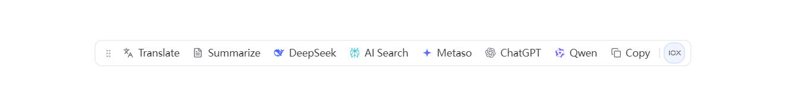
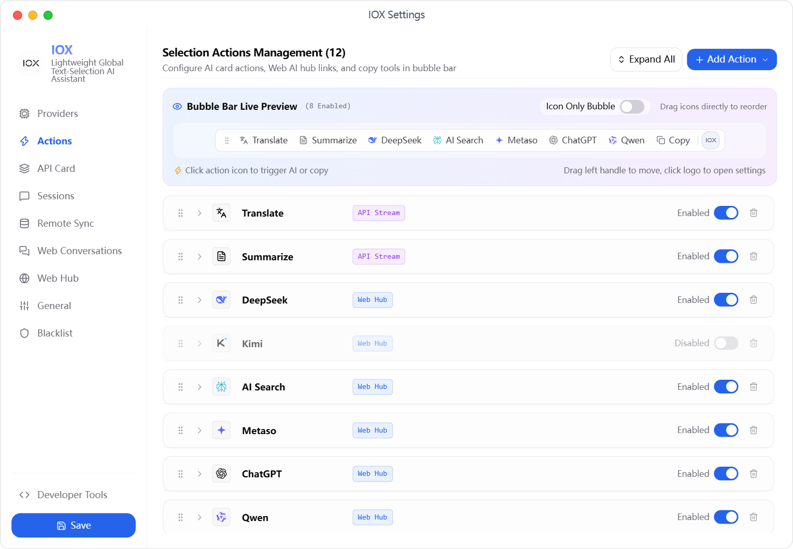
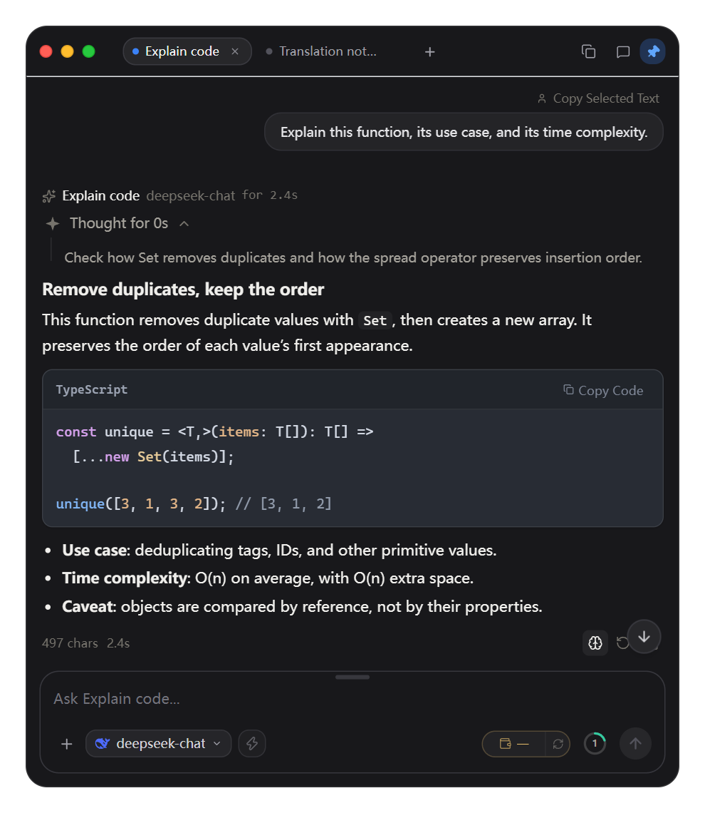
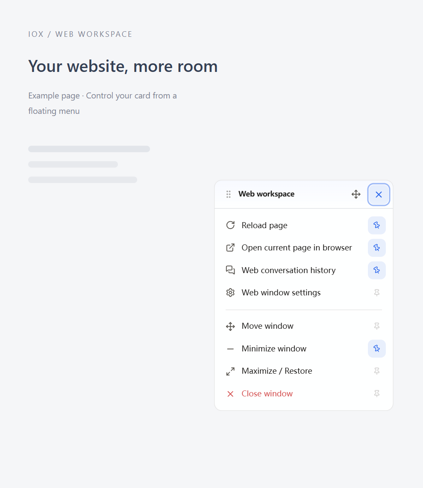

<p align="center">
  
</p>

<h1 align="center">IOX</h1>

<p align="center"><strong>Select text. Ask AI. Keep working.</strong></p>

<p align="center">
  <strong>English</strong> · <a href="README_zh.md">简体中文</a> ·
  <a href="https://github.com/AimAI-Labs/iox/releases">Downloads</a> ·
  <a href="https://github.com/AimAI-Labs/iox/issues">Feedback</a>
</p>

<p align="center">
  
  
  
  
  <a href="LICENSE"></a>
</p>

**IOX (Input/Output Extension)** is a Windows text-selection AI assistant built with Tauri 2, Rust, and React 19. Select text in another app, then translate, summarize, or run a custom action from a compact floating toolbar. Read API answers in place or continue in an integrated AI website window.



[Features](#features) · [Screenshots](#screenshots) · [Getting started](#getting-started) · [Configuration](#configuration) · [Data and privacy](#data-and-privacy) · [Development](#development)

## Features

- **Selection toolbar** — Global mouse and keyboard hooks detect selections. Movement checks, modifier filters, UI Automation, and a process blacklist help avoid accidental triggers. The bubble is shown without activating its window, preserving focus in the source app.
- **API conversations** — OpenAI-compatible streaming, collapsible reasoning, Markdown, math, highlighted code, quotes, follow-up questions, message editing, regeneration, multiple tabs, and Markdown export. Pin a card to protect it from new selections and passive dismissal.
- **Integrated websites** — Open web actions in separate WebView2 windows or one tabbed Web Hub. Pass text through URL templates or supported website input adapters, with optional automatic submission.
- **Floating website controls** — Optional headless mode replaces the website title bar with a draggable menu. Hover for pinned shortcuts; expand it for navigation and window controls. Pinned actions are shared across website cards.
- **File drag menu** — An optional global drag-and-hover menu passes attachments to supported website upload adapters. It is disabled by default; selecting a file with a click does not trigger it.
- **History and sync** — Local SQLite API history with deduplication and up to 200 sessions; separate website history collection and caching. Optional PostgreSQL sync shares API history between devices while local access remains available offline.
- **Desktop controls** — Floating ball, configurable global shortcut (default `Alt+Space`), system tray, Chinese/English UI, light/dark/system themes, and `classic` custom or `windows` native window frames.

## Screenshots

The images below are browser captures of the current UI components with sample data and simulated desktop calls. The website content is illustrative; these previews do not demonstrate native Windows focus, dragging, or live provider responses.

**Action management** — Configure API, website, and copy actions, reorder them, and preview the selection toolbar.



<details>
<summary>API conversation and floating website menu</summary>

| API card · dark theme | Website menu · light theme |
| --- | --- |
|  |  |

</details>

## Getting started

1. Open [Releases](https://github.com/AimAI-Labs/iox/releases) and choose an available Windows installer or portable ZIP. Extract a portable archive before running `iox.exe`. Windows needs the [Microsoft Edge WebView2 Runtime](https://developer.microsoft.com/en-us/microsoft-edge/webview2/).
2. Open settings from the tray or floating ball. For API actions, enter your endpoint and API key in **Providers**, fetch or enter model IDs, and choose a default model. The bundled provider entries have no keys or models configured.
3. In **Actions**, bind an API action to the provider, or enable a website action. Save your settings.
4. Select text in an app and click an action in the bubble. API actions open a conversation card; website actions open an integrated website window. Website accounts must be signed in inside IOX.

If the bubble does not appear, check automatic selection popup, the minimum selection length, required modifier, and the app blacklist in settings. You can also use the floating ball or change the global shortcut if another app already uses it.

## Configuration

### API and copy actions

An API action binds a provider to a prompt template. `{text}` is replaced by the selected text:

```text
Summarize the following text in three concise points, preserving important numbers:

{text}
```

Provider configuration includes the base URL, API key, model list, and default model. Use an endpoint implementing the OpenAI-compatible chat-completions streaming protocol; models and supported reasoning options depend on that endpoint. Compatible local services can also be used. IOX does not supply API credits.

A `copy` action copies the selected text without sending an AI request.

In **API Card**, configure card size, pinning and input focus on open, reasoning display, font size, code wrapping and line numbers, context turns, and `Enter` or `Ctrl+Enter` to send. Input autofocus is off by default.

### Website actions and Web Hub

Website actions run inside IOX's WebView2 environment. Its login state is separate from your external browser; existing browser sign-ins are not automatically reused.

- **URL template** — Include `{text}` in a query URL, for example `https://www.google.com/search?q={text}`. Selected text is URL-encoded before navigation.
- **Website input** — Supported presets fill the site's input through DOM adapters. You can configure input/submit selectors and automatic submission for custom actions. Website changes and login requirements can affect these integrations.
- **Window mode** — In **Web Hub**, choose independent windows or a shared tabbed window. Optionally enable **headless mode** to replace the title bar with a floating menu.

In headless mode, click the floating button to open the menu. By default, drag it to reposition the menu, or hold for 300 ms and drag to move the whole card. The delay is configurable from 0–10000 ms; 0 makes dragging move the card immediately. The menu's direct-drag toggle swaps these drag targets for that toolbar. Pin menu rows to add hover shortcuts across all website cards; unpin every row to disable those shortcuts.

Enable the file drag menu in **General** if needed, then drag files and pause for the configured hover delay (default 1000 ms). Attachment support depends on the target website adapter. **Web Conversations** contains collected website history, separate from locally saved API sessions; availability depends on the site and its signed-in state.

### Optional PostgreSQL sync

In **Remote Sync**, configure the PostgreSQL connection, SSL mode, and namespace. **Test Connection** checks the current form without saving it. Turn on the sync switch and save to enable background synchronization; **Sync Now** runs an immediate sync using the saved configuration and requires sync to be enabled. Sync is disabled by default and covers API history; SQLite remains the local source of truth if the remote database is unavailable.

Devices sharing history must use the same namespace. Different users must use different namespaces. Changes use timestamps to resolve conflicts; deletion records are retained locally for 30 days, so a device offline longer than that may restore an old deleted session. The 200-session retention limit also applies to synchronized history.

## Data and privacy

The data directory is resolved from `USERPROFILE`, then `HOME`, then the working directory:

| Build/environment | Default directory on Windows |
| --- | --- |
| Debug, or explicitly `IOX_ENV=dev` | `%USERPROFILE%\.iox-dev\` |
| Other Release builds | `%USERPROFILE%\.iox\` |

| File | Contents |
| --- | --- |
| `config.json` | Settings, actions, provider credentials, and optional sync credentials |
| `sessions.db` | SQLite API conversation history; `-wal` / `-shm` files may accompany it |
| `web-history-dev.json` / `web-history.json` | Debug / Release website history cache |
| `sessions.jsonl.migrated` | Backup of legacy JSONL history after successful one-time import |

API history is saved locally. Running an API action sends its request content to the configured provider; website actions pass content to the target website. Enabling PostgreSQL sync uploads API history to the database you configure.

API keys and the PostgreSQL password are currently stored as plaintext in `config.json`. Do not publish that file or include it in screenshots. For a consistent history backup, quit IOX before copying the data directory.

Selection extraction uses a guarded `Ctrl+C` flow with text clipboard backup and restoration. It does **not** guarantee restoration of images, file lists, rich text, or clipboard history. Copy actions and optional website auto-copy deliberately replace clipboard text.

## Development

### Requirements

Develop and validate the desktop app on Windows 10/11 x64 with:

- **Node.js 22**, matching [mise.toml](mise.toml).
- **pnpm 11.20.0**, declared in [package.json](package.json).
- **Rust stable with the MSVC toolchain**.
- **Microsoft C++ Build Tools**, including the **Desktop development with C++** workload and Windows SDK.
- **Microsoft Edge WebView2 Runtime**.

See the [Tauri Windows prerequisites](https://v2.tauri.app/start/prerequisites/) for native build dependencies.

```powershell
git clone https://github.com/AimAI-Labs/iox.git
cd iox
pnpm install
pnpm tauri dev
```

`pnpm tauri dev` starts Vite and the native app, using the development data directory. Vite requires port **1420** and fails if it is occupied. `pnpm dev` starts only the frontend server; a plain browser cannot provide native hooks, desktop IPC, or integrated website windows.

### Checks and packaging

Run commands from the repository root in PowerShell:

| Command | Purpose |
| --- | --- |
| `pnpm build` | TypeScript checks and Vite production build |
| `pnpm test` | Node regression tests in `tests/*.test.mjs` |
| `pnpm test:files` | File input and menu regressions |
| `pnpm test:floating-ball` | Floating ball regressions |
| `cargo check --manifest-path src-tauri/Cargo.toml` | Rust compile check |
| `cargo test --manifest-path src-tauri/Cargo.toml` | Rust regression tests |
| `cargo fmt --manifest-path src-tauri/Cargo.toml -- --check` | Rust format check |
| `pnpm tauri build` | Build the release executable and NSIS installer |

The release executable is `src-tauri/target/release/iox.exe`; NSIS installers are under `src-tauri/target/release/bundle/nsis/`. The [release workflow](.github/workflows/release.yml) runs on `v*` tags or manual dispatch and additionally packages a portable ZIP. A local `pnpm tauri build` does not produce that ZIP automatically.

Node tests do not run the Python browser scripts or manual desktop checks. Changes to focus, pinning, multi-monitor/DPI behavior, file dragging, or website injection also need Windows desktop verification.

### Code layout

| Path | Responsibility |
| --- | --- |
| [`src-tauri/src/`](src-tauri/src/) | Native hooks, window policy, configuration, AI requests, website adapters, and storage |
| [`src-tauri/src/chat_store/`](src-tauri/src/chat_store/) | SQLite transactions, deduplication, migration, and retention |
| [`src-tauri/src/sync/`](src-tauri/src/sync/) | Optional PostgreSQL history sync |
| [`src/conversation/`](src/conversation/) | Conversation, generation, tab, and save-revision state |
| [`src/components/`](src/components/) | Overlay, settings, history, and website controls |
| [`src/hooks/`](src/hooks/) and [`src/lib/`](src/lib/) | Event/IPC adapters and shared logic |
| [`src/themes/`](src/themes/) and [`src/locales/`](src/locales/) | Interface styles, tokens, and Chinese/English text |
| [`tests/`](tests/) | Regression tests and controlled browser fixtures |

The frontend uses TypeScript 5.8, Vite 7, Tailwind CSS 3.4, and Zod 4. The Rust backend uses Tokio, reqwest, SQLite, and Win32/COM integrations. See [AGENTS.md](AGENTS.md) for state ownership and change-specific verification requirements.

## Contributing

Report problems through [Issues](https://github.com/AimAI-Labs/iox/issues), including the IOX build, Windows version, reproduction steps, and expected behavior. Remove credentials and private conversation content from logs and screenshots. For code changes, follow [AGENTS.md](AGENTS.md), update both UI languages when adding text, and include the checks you actually ran in your pull request.

## License

This project is licensed under the [MIT License](LICENSE).
