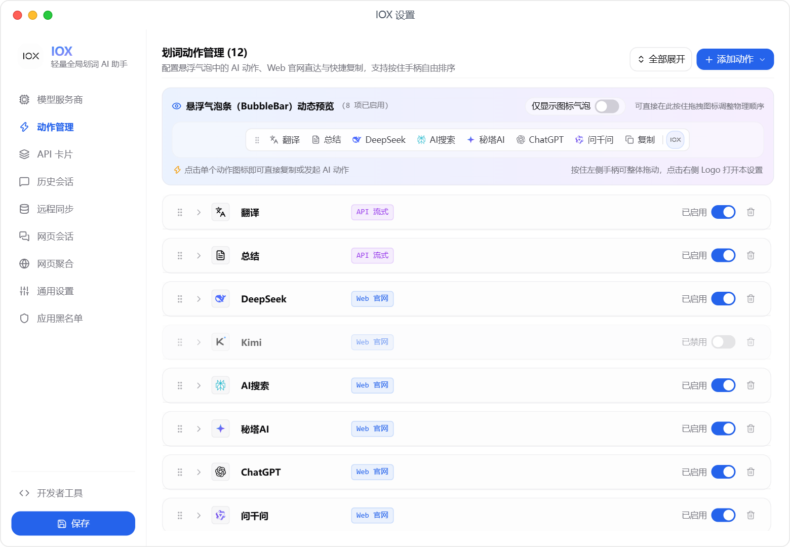
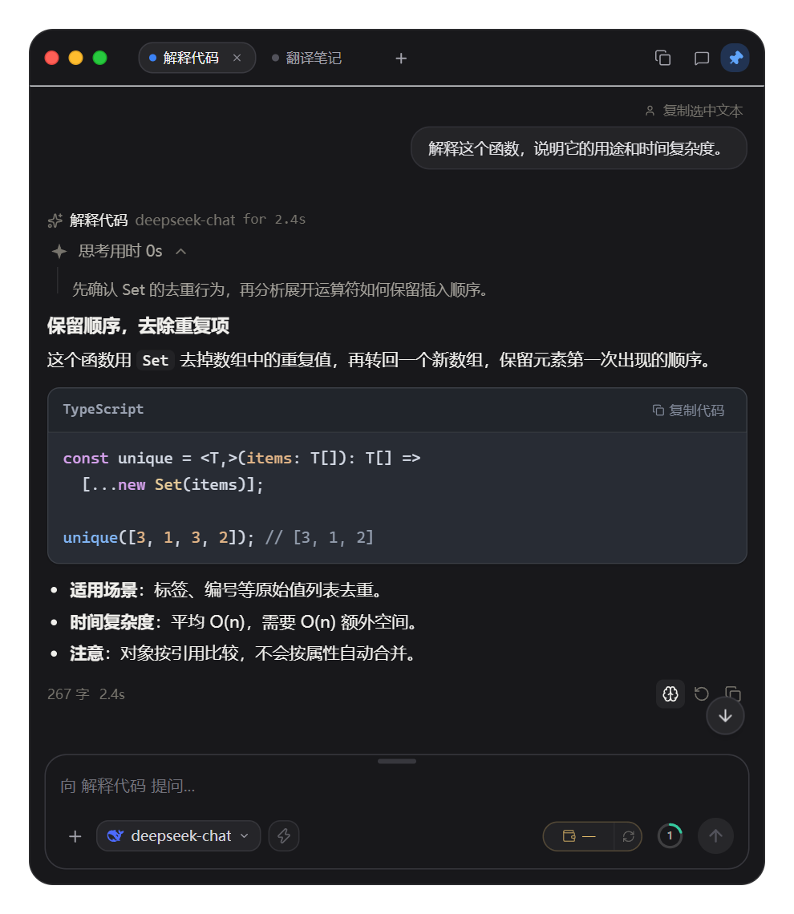
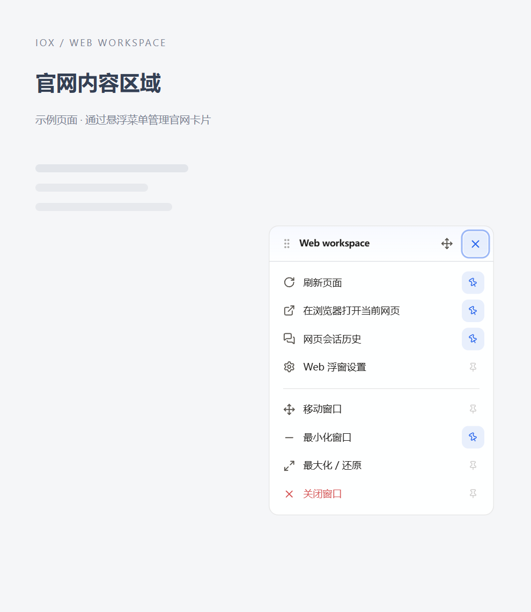

<p align="center">
  
</p>

<h1 align="center">IOX</h1>

<p align="center"><strong>划选文本，调用 AI，继续手头的工作。</strong></p>

<p align="center">
  <a href="README.md">English</a> · <strong>简体中文</strong> ·
  <a href="https://github.com/AimAI-Labs/iox/releases">下载</a> ·
  <a href="https://github.com/AimAI-Labs/iox/issues">反馈</a>
</p>

<p align="center">
  
  
  
  
  <a href="LICENSE"></a>
</p>

**IOX（Input/Output Extension）** 是基于 Tauri 2、Rust 和 React 19 的 Windows 全局划词 AI 助手。在其他应用中选中文本，即可通过悬浮气泡翻译、总结或执行自定义动作；既能在原地阅读 API 回答，也能进入内置 AI 官网窗口继续交流。


[功能](#功能) · [界面预览](#界面预览) · [快速上手](#快速上手) · [配置](#配置) · [数据与隐私](#数据与隐私) · [开发](#开发)

## 功能

- **全局划词气泡**：通过全局鼠标与键盘钩子感知选区，结合位移判断、修饰键过滤、UI Automation 和进程黑名单减少误触。气泡显示时不激活窗口，保留宿主应用的焦点。
- **API 多轮对话**：支持 OpenAI 兼容流式输出、可折叠思考内容、Markdown、公式、代码高亮、引用追问、编辑消息、重新生成、多标签和 Markdown 导出。固定卡片后，可防止新划词接管与被动退场。
- **内置官网窗口**：Web 动作可以分别打开独立 WebView2 窗口，或汇聚到统一标签窗口；通过 URL 模板或适配器填入文本，可选择自动提交。
- **官网悬浮菜单**：可选无头模式用可拖动菜单替代标题栏，悬停显示已固定的快捷操作，展开后提供导航与窗口控制。固定项在所有官网卡片间共享。
- **文件拖拽菜单**：可选的全局拖拽悬停菜单，将附件交给支持的官网上传适配器。默认关闭，单击选中文件不会触发。
- **历史与同步**：API 历史使用本地 SQLite，支持去重并保留最多 200 条会话；官网历史独立采集与缓存。可选 PostgreSQL 同步在设备间共享 API 历史，离线时仍可使用本地记录。
- **桌面入口与外观**：悬浮球、可配置全局快捷键（默认 `Alt+Space`）、系统托盘、中英双语、暗色／浅色／跟随系统，以及 `classic` 自绘与 `windows` 原生两种窗口外框。

## 界面预览

以下图片通过浏览器截取当前真实 UI 组件，使用示例数据与模拟桌面调用。官网内容为示意页面；截图不代表已验证原生 Windows 焦点、拖动或真实服务商响应。

**动作管理**：配置 API、官网与复制动作，调整顺序，并实时预览划词气泡。



<details>
<summary>展开查看 API 卡片与官网悬浮菜单</summary>

| API 卡片 · 暗色主题 | 官网菜单 · 浅色主题 |
| --- | --- |
|  |  |

</details>

## 快速上手

1. 前往 [Releases](https://github.com/AimAI-Labs/iox/releases)，选择可用的 Windows 安装包或便携 ZIP。便携版先解压，再运行 `iox.exe`。Windows 需要安装 [Microsoft Edge WebView2 Runtime](https://developer.microsoft.com/en-us/microsoft-edge/webview2/)。
2. 从托盘或悬浮球打开设置。使用 API 动作前，在**模型服务商**中填写接口地址与 API Key，拉取或手动填写模型 ID，并选择默认模型。内置服务商条目尚未配置密钥与模型。
3. 在**动作管理**中为 API 动作绑定服务商，或启用官网动作，然后保存设置。
4. 在应用中选中文本，点击气泡动作。API 动作会打开对话卡片，Web 动作会打开内置官网窗口。官网账号需要在 IOX 内登录。

若气泡未出现，请检查设置中的自动划词弹出、最小选区长度、触发修饰键与应用黑名单。也可使用悬浮球入口；全局快捷键与其他软件冲突时可自行更改。

## 配置

### API 与复制动作

API 动作将服务商与提示词模板绑定，`{text}` 会替换为选中文本：

```text
请将以下内容总结为三个简洁要点，保留重要数字：

{text}
```

服务商配置包含 Base URL、API Key、模型列表和默认模型。接口需实现 OpenAI 兼容的聊天补全流式协议，模型与思考选项取决于该接口；也可以接入兼容的本地服务。IOX 本身不提供 API 额度。

`copy` 是独立动作类型，直接复制选中文本，不发起 AI 请求。

在 **API 卡片**中可以设置卡片尺寸、打开时是否固定与聚焦输入框、思考内容展示、字号、代码换行与行号、上下文轮数，以及使用 `Enter` 或 `Ctrl+Enter` 发送。输入框默认不自动获取焦点。

### 官网动作与网页聚合

官网动作运行在 IOX 的 WebView2 环境中，登录状态独立于外部浏览器，不会自动复用浏览器中已有的登录。

- **URL 模板**：在查询地址中使用 `{text}`，例如 `https://www.google.com/search?q={text}`；导航前会对选中文本进行 URL 编码。
- **网页输入**：支持的预设通过 DOM 适配器填写官网输入框。自定义动作可配置输入框／提交按钮选择器与自动提交。网站改版或登录要求可能影响适配。
- **窗口模式**：在**网页聚合**中选择独立窗口或统一标签窗口；也可以开启**无头模式**，用悬浮菜单替代标题栏。

无头模式下，单击悬浮按钮展开菜单；默认拖动按钮移动菜单，长按 300 毫秒后拖动整个卡片。长按时长可设为 0–10000 毫秒，0 表示直接拖动卡片。菜单中的“直接拖动整个卡片”开关可在当前工具栏内互换两种拖动目标。通过每行图钉固定操作，即可在所有官网卡片中使用悬停快捷操作；全部取消固定后关闭此功能。

如需文件输入，在**通用设置**中启用文件拖拽菜单，拖动文件并停留至设定时长（默认 1000 毫秒）。附件能力取决于目标官网适配器。**网页会话**展示采集到的官网历史，与本地 API 会话分别管理，可用性取决于网站与登录状态。

### 可选 PostgreSQL 同步

在**远程同步**中填写 PostgreSQL 连接信息、SSL 模式和命名空间。“测试连接”使用当前表单，无需先保存。打开同步开关并保存后启用后台同步；“立即同步”使用已保存的配置执行一次同步，需要先启用同步。同步默认关闭，范围为 API 历史；远程数据库不可用时，本地 SQLite 仍是读写真源。

共享历史的设备使用相同命名空间，不同用户必须使用不同命名空间。修改按时间戳解决冲突；本地删除记录保留 30 天，离线超过该窗口的设备可能恢复旧的已删除会话。同步历史同样受最多 200 条会话的保留上限约束。

## 数据与隐私

数据根目录优先取 `USERPROFILE`，其次取 `HOME`，最后回退至当前工作目录：

| 构建／环境 | Windows 默认目录 |
| --- | --- |
| Debug，或显式设置 `IOX_ENV=dev` | `%USERPROFILE%\.iox-dev\` |
| 其他 Release 构建 | `%USERPROFILE%\.iox\` |

| 文件 | 内容 |
| --- | --- |
| `config.json` | 设置、动作、服务商凭据与可选同步凭据 |
| `sessions.db` | SQLite API 会话历史，运行时可能伴随 `-wal`／`-shm` 文件 |
| `web-history-dev.json`／`web-history.json` | Debug／Release 官网历史缓存 |
| `sessions.jsonl.migrated` | 旧版 JSONL 历史成功完成一次性导入后的备份 |

API 历史保存在本地。执行 API 动作会将请求内容发送到配置的服务商；Web 动作会将内容传给目标官网。开启 PostgreSQL 同步后，API 历史会上传到自行配置的数据库。

API Key 与 PostgreSQL 密码目前以明文保存在 `config.json` 中，请勿公开该文件或将其截入图片。备份历史时，先退出 IOX，再复制数据目录，以保证备份一致。

划词取词使用受保护的 `Ctrl+C` 流程，备份并恢复的是**文本剪贴板**，不保证图片、文件列表、富文本或剪贴板历史的完整还原。复制动作与可选的官网自动复制会主动替换剪贴板文本。

## 开发

### 环境要求

桌面开发与验证面向 Windows 10／11 x64，需要：

- **Node.js 22**，与 [mise.toml](mise.toml) 一致。
- **pnpm 11.20.0**，由 [package.json](package.json) 声明。
- **Rust stable 与 MSVC 工具链**。
- **Microsoft C++ Build Tools**，包含“**使用 C++ 的桌面开发**”工作负载与 Windows SDK。
- **Microsoft Edge WebView2 Runtime**。

原生构建依赖的安装说明参见 [Tauri Windows 前置条件](https://v2.tauri.app/start/prerequisites/)。

```powershell
git clone https://github.com/AimAI-Labs/iox.git
cd iox
pnpm install
pnpm tauri dev
```

`pnpm tauri dev` 同时启动 Vite 与原生应用，使用开发数据目录。Vite 固定占用 **1420** 端口，被占用时直接失败。`pnpm dev` 只启动前端服务，普通浏览器无法提供原生钩子、桌面 IPC 或内置官网窗口。

### 检查与打包

从仓库根目录使用 PowerShell 执行：

| 命令 | 用途 |
| --- | --- |
| `pnpm build` | TypeScript 检查与 Vite 生产构建 |
| `pnpm test` | 执行 `tests/*.test.mjs` 中的 Node 回归 |
| `pnpm test:files` | 文件输入与菜单回归 |
| `pnpm test:floating-ball` | 悬浮球回归 |
| `cargo check --manifest-path src-tauri/Cargo.toml` | Rust 编译检查 |
| `cargo test --manifest-path src-tauri/Cargo.toml` | Rust 回归测试 |
| `cargo fmt --manifest-path src-tauri/Cargo.toml -- --check` | Rust 格式检查 |
| `pnpm tauri build` | 构建 Release 可执行文件与 NSIS 安装包 |

可执行文件位于 `src-tauri/target/release/iox.exe`，NSIS 安装包位于 `src-tauri/target/release/bundle/nsis/`。[发布工作流](.github/workflows/release.yml) 由 `v*` tag 或手动触发，并额外生成便携 ZIP；本地 `pnpm tauri build` 不会自动生成该 ZIP。

Node 测试不会运行 Python 浏览器脚本或桌面手动检查。焦点、固定卡片、多屏／DPI、文件拖拽与官网注入等变更，还需要 Windows 桌面验证。

### 代码结构

| 路径 | 职责 |
| --- | --- |
| [`src-tauri/src/`](src-tauri/src/) | 原生钩子、窗口政策、配置、AI 请求、官网适配与存储 |
| [`src-tauri/src/chat_store/`](src-tauri/src/chat_store/) | SQLite 事务、去重、迁移与保留上限 |
| [`src-tauri/src/sync/`](src-tauri/src/sync/) | 可选 PostgreSQL 历史同步 |
| [`src/conversation/`](src/conversation/) | 对话、生成、标签与保存修订状态 |
| [`src/components/`](src/components/) | 悬浮界面、设置、历史与官网控件 |
| [`src/hooks/`](src/hooks/) 与 [`src/lib/`](src/lib/) | 事件／IPC 适配器与共享逻辑 |
| [`src/themes/`](src/themes/) 与 [`src/locales/`](src/locales/) | 外观策略、样式令牌与中英文案 |
| [`tests/`](tests/) | 回归测试与受控浏览器夹具 |

前端使用 TypeScript 5.8、Vite 7、Tailwind CSS 3.4 与 Zod 4；Rust 后端使用 Tokio、reqwest、SQLite 与 Win32／COM 集成。状态归属和按变更范围执行的验证要求见 [AGENTS.md](AGENTS.md)。

## 参与贡献

欢迎通过 [Issues](https://github.com/AimAI-Labs/iox/issues) 报告问题，请附上 IOX 构建版本、Windows 版本、复现步骤和预期行为，并移除日志与截图中的凭据及私人会话内容。提交代码前请遵循 [AGENTS.md](AGENTS.md)，新增界面文案同时更新中英文，并在 Pull Request 中说明实际执行的检查。

## 许可证

本项目采用 [MIT 许可证](LICENSE)。
